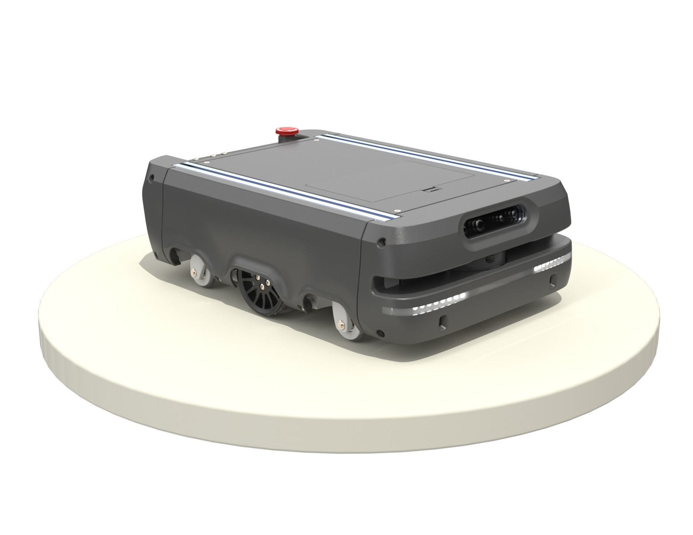

# Cloudy MK2 Mini-AGV: 3D-Printed ROS 2 Mobile Robot (Refurbished)



A fully 3D-printed differential-drive robot base for ROS 2. Two NEMA 17 steppers drive belt-reduced wheels, four sprung casters keep it level, and the closed body holds an on-board Linux computer, a 2D lidar, a depth camera and an ESP32 running micro-ROS. This is a refurbished remix of [Cloudy Mini-AGV MK2](https://github.com/robolaunch/Cloudy-MKII-STL-models) by robolaunch (designed by Mete Cengiz).

## Install and build guide

Remix of the Apache-2.0 Cloudy Mini-AGV MK2 by robolaunch (designed by Mete Cengiz). STL files are unmodified. Guide and combined parts list by Hawkridge.

### Parts bought separately

These parts are not in the shop list:

- 6S1P 18650 Li-ion pack (22.2 V, about 3200 mAh) with a BMS: buy it from a battery shop that builds 18650 packs. A 6S LiPo also works.
- Self-tapping screws DIN 7049: ST2.2 x 6.5 (19), x 9.5 (5), x 13 (4) and ST2.9 x 6.5, x 9.5, x 16 (4 each). Buy them from a hardware store or fastener supplier.
- Extension springs for the casters: 1/4 x 7/8 inch (4) and 11/32 x 1-27/32 inch (2). Buy them from a spring supplier.

### 1. Print the parts

Material: PLA or PLA+. Mechanical parts: 0.3 mm layers, 100% infill, supports on. The 50T drive pulley prints better at 0.15 mm. Body panels: 0.2 mm layers, any colour. Bed size: at least 250 x 200 mm.

The number after `_X` in each file name is how many to print.

| Group | Files |
|---|---|
| Caster wheels | 0401_001, 0401_003, 0401_004, 0401_005, 0401_006, 0404_012, 0404_017, 0404_018, 0404_020, 0404_070 |
| Drive units | 0404_028_50T, 0404_029, 0404_030, 0404_031, 0404_060, 0404_032, 0404_034, 0404_035 |
| Frame | 0404_014 (rear), 0404_024 (front), 0404_033 (middle), 0404_039 (clip) |
| Battery | 0404_052 (cover), 0404_067 (bottom) |
| Body panels | 0404_044 (front), 0404_047 and 0404_065 (rear), 0404_049 (top), 0404_055 (left), 0404_064 (right) |

Small brackets for the electronics, the clear light covers and the soft drive tyres are not part of this file set. Plan to mount the boards on standoffs, and give each drive wheel a tyre for grip.

### 2. Caster wheels (make four: two left, two right)

1. Press M4 nuts into their pockets. Tap gently with a small hammer.
2. Press the 634 bearings into the pockets and lock them with the DIN 472 circlips. Some bearings have no circlip groove; the frame holds those once assembled.
3. Fit the O-ring on each caster wheel.
4. Join pivot, links, lower frame and fixture with M4 x 16 and M4 x 30 screws and M3 x 16 countersunk screws.

### 3. Drive units (make two)

1. Press M3 and M4 nuts into the belt box parts.
2. Slide the motor flange into the belt box base before mounting the motor.
3. Mount the NEMA 17 with the connector facing up. Fit the GT2 16T pulley on the motor shaft.
4. Fit the 61804 and 61800 bearings and the 50T printed pulley on the drive wheel, then add the 122 mm belt.
5. Close the belt box and tension the belt with the M3 x 25 screws evenly. Leave about 1 mm of play.

### 4. Frame and body

1. Join the front, middle and rear frames with the 20 x 20 profiles and M3/M4 screws.
2. Mount the four caster units with their springs and the two drive units.
3. Fit the battery bottom and cover, then the side, front, rear and top panels with the self-tapping screws.

### 5. Electronics

Stack in the electronics bay: ESP32 board, CNC shield with two DRV8825 drivers, I2C multiplexer, receiver, both UBECs and the fan. Front bumper: two LED bars, three proximity sensors, depth camera and lidar. Rear: two LED bars, emergency stop and two DC power connectors.

- Set the DRV8825 current limit to suit the 1.7 A motors before driving.
- Use one 5 V UBEC for the ESP32 side and the 6 A UBEC for the on-board computer.
- Wire the emergency stop so it cuts motor power.

### 6. Software

1. Flash the ESP32 firmware from the robolaunch/cloudy repository with Arduino IDE 2 (ESP32 core 2.0.2, micro_ros_arduino, FastAccelStepper 0.28.3, board "DOIT ESP32 DEVKIT V1").
2. On the on-board computer, build the ROS 2 workspace and the micro-ROS agent, then start the agent on the ESP32 serial port.
3. Try the Gazebo simulation first: `ros2 launch robolaunch_cloudy_simulator launch_sim.launch.py`.

### Safety

The 6S pack stores a lot of energy. Use a pack with a BMS, fuse the main line, and never short the power rails. Lift the wheels off the table the first time the motors run.

### Software and source links

- ESP32 firmware (`firmware.ino`, plus the FlySky receiver and sensor variants): `source/upstream/cloudy/robolaunch_cloudy_hardware/firmware/` in this repository.
- ROS 2 hardware interface (ros2_control to micro-ROS): `source/upstream/cloudy/robolaunch_cloudy_hardware/` in this repository.
- Original robolaunch documentation (mechanical, electronics, wiring, software, launching): `source/upstream/cloudy/docs/mini-agv/` in this repository.
- Original assembly step images: `source/upstream/Cloudy-MKII-STL-models/images/` in this repository.
- Full ROS 2 workspace (description, bringup, navigation, simulator and the lidar driver), not copied here: `git clone https://github.com/robolaunch/cloudy.git`, then `git checkout a15f636` for the version this guide was written against.
- micro-ROS agent on the on-board computer: `ros2 run micro_ros_setup create_agent_ws.sh`, `ros2 run micro_ros_setup build_agent.sh`, `source install/local_setup.sh`, then `ros2 run micro_ros_agent micro_ros_agent serial --dev /dev/ttyUSB0` (use the ESP32 port shown by `sudo dmesg | grep USB`).

## Bill of Material

[Bill of Material (PDF)](docs/Cloudy%20MK2%20Mini-AGV%20Robot%20-%20Bill%20of%20Material.pdf): every part to buy, with shop links.

## Documentation download

This repository is the documentation and source download for the build.

- **Download ZIP:** use GitHub's **Code → Download ZIP** button, or clone:

  ```bash
  git clone https://github.com/ToolKnox/hawkridge-cloudy-mk2-mini-agv-ros2-robot.git
  ```

- **Build guide:** this README, also as [`docs/build-guide.md`](docs/build-guide.md).
- **Print files (STL, 30 parts):** [`source/upstream/Cloudy-MKII-STL-models/`](source/upstream/Cloudy-MKII-STL-models/)
- **Original assembly step images:** [`source/upstream/Cloudy-MKII-STL-models/images/`](source/upstream/Cloudy-MKII-STL-models/images/)
- **ESP32 firmware and ROS 2 hardware interface:** [`source/upstream/cloudy/robolaunch_cloudy_hardware/`](source/upstream/cloudy/robolaunch_cloudy_hardware/)
- **Original robolaunch documentation:** [`source/upstream/cloudy/docs/mini-agv/`](source/upstream/cloudy/docs/mini-agv/)
- **Full ROS 2 workspace (upstream):** https://github.com/robolaunch/cloudy/tree/a15f636ea142e3c4db07092d80f6eb8958747eed

## Repository contents

- `docs/`: the build guide and the upstream mirror manifest.
- `download-documentation/`: how to download this package.
- `images/`: cover image.
- `source/upstream/Cloudy-MKII-STL-models/`: full mirror of [robolaunch/Cloudy-MKII-STL-models](https://github.com/robolaunch/Cloudy-MKII-STL-models) at commit `2846da3e85a7448f8292eedd4f1e76d3cecd8f07` (30 STL files, assembly images, license).
- `source/upstream/cloudy/`: the license, README, documentation and `robolaunch_cloudy_hardware` (ESP32 firmware and ROS 2 hardware interface) from [robolaunch/cloudy](https://github.com/robolaunch/cloudy) at commit `a15f636ea142e3c4db07092d80f6eb8958747eed`. The other ROS 2 packages stay in the upstream repository; see the software links above.

## Credits and license

Remix of [Cloudy Mini-AGV MK2](https://github.com/robolaunch/Cloudy-MKII-STL-models) by robolaunch, designed by Mete Cengiz, licensed under the Apache License 2.0. Print files mirrored from commit [`2846da3`](https://github.com/robolaunch/Cloudy-MKII-STL-models/tree/2846da3e85a7448f8292eedd4f1e76d3cecd8f07); firmware and documentation from [`a15f636`](https://github.com/robolaunch/cloudy/tree/a15f636ea142e3c4db07092d80f6eb8958747eed). The cover is the original CAD render from `source/upstream/Cloudy-MKII-STL-models/images/`. The license text is kept at [`LICENSE`](LICENSE), [`source/upstream/Cloudy-MKII-STL-models/LICENSE`](source/upstream/Cloudy-MKII-STL-models/LICENSE) and [`source/upstream/cloudy/LICENSE`](source/upstream/cloudy/LICENSE). No endorsement by robolaunch is implied.

Changes by Hawkridge, updated for modern use: one combined purchase list with one row per screw length, a grouped print table and a shorter build guide in build order. Files under `source/upstream/` are unmodified.
